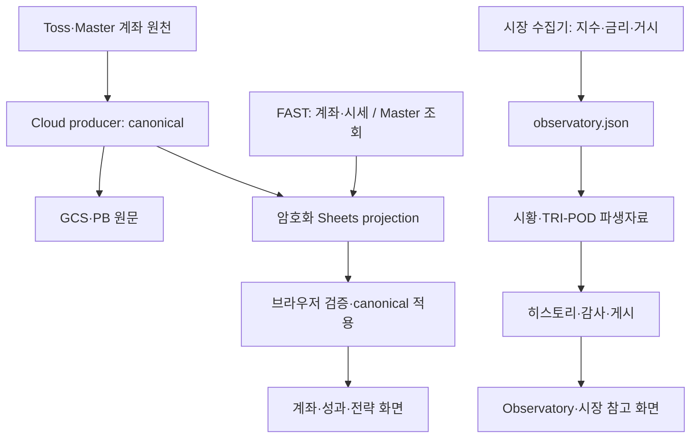

# Control Tower 데이터 흐름 개편 · 2026-10-17

## 점검 범위와 확인 수준

- 화면/시장 저장소 기준: `mauveplace/jjooni-control-tower`의 `bae0b90fa1fe1e2ad3315ae918137cbeee3e57b1`.
- 계좌 생산 저장소 기준: `mauveplace/jjooni-ai-trader`의 `f160cfe7cb6099016a32202bf6322aa31ea53297`.
- 계좌 생산은 `services/ct_producer/pipeline.py`, canonical builder/contract,
  browser projection, FAST server/Dockerfile, 최신 ownership 변경 #490을 직접 읽었다.
- 서버 파일을 읽은 것은 현재 배포 이미지의 코드/실행 상태를 증명하지 않는다.
  GCS의 private canonical/PB 원문 및 실제 Cloud Run revision은 이번 검증에 포함되지 않았다.
- 공개 저장소 전체 트리, 실제 로더와 참조 모듈, 수집/게시 도구, 워크플로,
  기존 회귀검증을 조사했다. 복호화된 `payload.json` 내부의 구형 앱은 실행 검증하지 않았다.
- 금액·수익률을 임의로 재작성하지 않는다. 자동주문 기능은 추가하지 않는다.

## 현재 데이터 경로



Master 직접 조회 결과는 거래 보완 경로이며 canonical 계좌 원본과 동일한
권한을 가진 별도의 전체 계좌 원본으로 취급하지 않는다. FAST와 정기 producer가
같은 게시 위치를 사용하는 부분의 교차 실행 검증은 서버 이관 항목이다.

## 확인된 문제와 이번 수정

| 문제 | 근거 | 조치 |
|---|---|---|
| 부팅 복구가 여러 갱신 경로를 깨움 | boot coordinator와 FAST recovery가 가짜 `visibilitychange`를 발생 | 해당 방송을 제거하고 LIVE feed만 명시적으로 요청 |
| 동시 조회 호출자가 동일 완료를 기다리지 못함 | LIVE bridge가 busy이면 즉시 반환 | 진행 중인 Promise를 공유; 복구 요청은 5초 간격 제한 |
| 부팅 중 로더 재진입 여지 | 기존 guard는 ACTIVE만 검사; FAST도 별도 로더 생성 | WAITING/LOADING 재진입 차단; 재시작 권한은 coordinator로 통일 |
| 히스토리가 파생자료 재계산 전에 저장됨 | publisher의 최초 commit과 rebase 후 처리 순서 | `파생 계산 → 히스토리 → 감사`를 공통 함수로 통일 |
| 원본과 두 파생자료의 게시 목록이 제각각 | hourly/daily는 원본만, sidecar는 자체 단독 push | 핵심 갱신은 market bundle; 파생자료 게시 요청은 원본·형제 파생자료까지 포함 |
| 게시 중 재수집으로 입력이 바뀔 가능성 | 독립 public sidecar의 외부 데이터 수집 | canonical 입력 옵션을 추가해 같은 원본에서 계산; 공통 publisher 사용 |
| 다른 작업의 builder 전역 경로를 바꿈 | publisher가 `pulse.DATA/OUT`, `public.OUT` 재할당 | 출력·데이터 경로를 함수 인수로 전달 |
| TRI-POD 규칙 중복 | public builder와 history builder의 별도 임계값 로직 | 순수 `tripod_rules.py` 공유 |
| VIX 누락일에 history 쪽 NDX 레짐 진행도 멈춤 | history가 레짐 계산 전에 해당 날짜를 건너뜀 | NDX 레짐은 진행하고 그날 신호만 생략; 현재/과거 신호 일치 검증 |
| 오래된 소스 교체 작업을 다시 실행 가능 | 이전 버전 문자열을 교체하는 일회성 Actions | 20개를 `ops/archive/workflows/`로 이동; 스케줄 작업 유지 |

한국 금리·가상자산의 독립 collector가 `observatory.json`만 게시하는 경로는
market bundle에 강제로 편입하지 않는다. 지수·VIX 계산 실패가 해당 개별 수집의
게시까지 막지 않도록 분리 경계를 유지한다.

## 서버 쪽에서 남은 주요 구조 문제

1. **계좌 소유권 계약이 계층마다 다르다.** 정기 canonical 경로의
   `ct_active_universe.py`와 `ct_data_contract_five_account.py`는 아직
   TOSS/ISA/PENSION/IRP/TRIPOD 5계좌를 기대한다. 반면 #490의
   `manual_intraday.owned_accounts()`는 FAST 경계에서 TRI-POD를
   TOSS 소속 비가산 전략으로 바꾸고 4개 실계좌 NAV를 합산한다. 브라우저도
   4개 실계좌를 사용한다. 따라서 FAST 화면의 정합성만으로 원문 PB까지
   같은 계약이라고 판정할 수 없다. 실제 중복 금액 발생은 이번 소스 조사만으로
   확정하지 않았다.
2. **FAST 실행 소스가 Docker 빌드 과정에서 생성된다.**
   `ops/ct-fast/Dockerfile`은 BASE_IMAGE 위에 다수의 `patch_*.py`를 순서대로
   실행한다. Git의 `server.py` 한 파일과 실제 실행 파일이 같다고 볼 수 없다.
   BASE_IMAGE의 정확한 digest와 변환 후 파일을 확보한 뒤 명시적인 모듈로
   이관해야 한다. 패치를 순서 없이 제거해서는 안 된다.
3. **계좌 builder는 버전 체인·전역 함수 교체를 여전히 사용한다.**
   `build_ct_canonical_five_account → build_ct_canonical_only → v19…v3`와
   함수 포인터 교체가 남아 있다. 원천별 adapter, 평가/성과의 순수 계산,
   projection 변환, publisher를 분리하는 다음 이관 대상이다.
4. **서버 설계 문서가 구형이다.** private 저장소의
   `docs/control-tower-architecture.md`에는 6계좌·AI broker 단계가 남아 있지만
   실제 pipeline은 AI를 제외한 경로다. 현재 배포 revision 확인 후 문서와
   코드 계약을 함께 정정해야 한다.
5. **DOM 보정 계층이 아직 많다.** 이번 조사 시 브라우저 JS 69개, 필수 부팅
   모듈 33개이며 정적 분석상 반복 타이머/observer 호출 지점이 남아 있다.
   이 숫자는 실제 동시 실행 개수나 충돌 건수가 아니다. 암호화된 앱의 핵심
   renderer를 확보한 뒤 화면 영역별로 소유자를 하나씩 지정하고 후속 보정을
   흡수해야 한다. 파일을 한 덩어리로 합치는 것만으로 해결됐다고 보지 않는다.
6. **워크플로의 완료 이벤트 연결이 복잡하다.** market, calendar, pulse,
   supplemental, freshness 작업의 upstream을 inventory에 기록했다.
   스케줄/수동 버튼을 유지하면서 게시 결과를 소비하는 구조로 이관하되,
   단순히 모든 작업을 하나의 실패 의존 체인으로 합치지 않는다.

## 다음 서버 이관의 완료 조건

1. 실행 중인 producer/FAST 이미지 digest와 effective source를 고정한다.
2. 소유권 규칙을 원문 canonical 생성 시 한 번 적용한다. 실계좌는
   TOSS/ISA/PENSION/IRP, TRI-POD는 TOSS에 귀속된 비가산 전략이다.
   ISA의 전략 범위는 나스닥 레버리지이며 다른 계좌와 중복 집계하지 않는다.
3. 동결한 동일 입력을 구형/신형에 재생해 보유수량·현금·NAV·평가손익·일간손익,
   현금흐름·실현손익·배당·환율효과를 대사한다. 빈값과 0을 구분한다.
4. PB 원문·브라우저·전략 장부가 동일 snapshot_id와 소유권 계약을 사용해야 한다.
   원금/거래 시점 환율, 기존 수익률 기준일과 히스토리는 재설정하지 않는다.
5. FAST와 정기 producer 동시 실행, 수집 한 군데 장애, 최신 원본 도착 순서 역전,
   장 마감/휴장, 모바일/태블릿의 재접속을 검증한 뒤 교체한다.
6. 검증을 마친 영역의 구형 writer·보정 스크립트·빌드 패치를 함께 제거한다.

이 문서는 전체 재작성 완료 선언이 아니다. 이번 변경은 실제로 확인한 부팅 및
시장 데이터 게시의 결함을 수정하고, 서버/renderer 이관의 근거와 통과 기준을
고정한 것이다. 다음 단계에서도 AUTOBOT·자동매매는 운영 대상에 포함하지 않는다.

## 재현 가능한 검증

```bash
python -m pip install -r tools/requirements-observatory.txt
python tools/audit_control_tower_architecture.py --check
python -m unittest discover -s tests -p 'test_*.py'
node --test tests/*.test.cjs
git diff --check
```

Architecture Contract CI가 위 검증과 원천/게시/모듈 inventory를 PR에서 실행한다.
동시 원본 게시를 실제 로컬 Git remote/rebase로 재현하고, 최종 시황과 정확히
동일한 immutable archive가 존재하는지 검증한다. 브라우저 스케줄러 검증은
중복 호출의 Promise 공유, 실패 후 해제, 5초 복구 제한, 숨김 상태와 로더
재진입을 검사한다. 개인 화면의 실제 복호화·레이아웃 확인은 별도 배포 검증이다.
